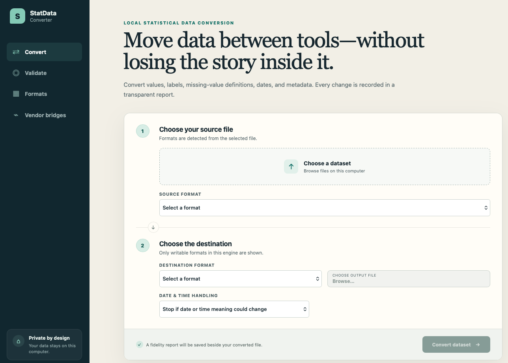

# StatData Converter

[](https://github.com/winkhaing/StatDataConvertor/actions/workflows/checks.yml)
[](https://github.com/winkhaing/StatDataConvertor/actions/workflows/desktop-package-ci.yml)
[](LICENSE)

StatData Converter is a local-first, open-source desktop application for moving
datasets between statistical software formats. It is designed around two rules:

1. data never leaves the user's computer; and
2. every conversion produces a machine-readable fidelity report.

## Application preview



## Downloads

Windows, macOS, and Linux packages are published on the
[GitHub Releases page](https://github.com/winkhaing/StatDataConvertor/releases).
Review the release notes, package smoke-test result, signature status, and
checksum before installation.

This repository contains the tenth implementation milestone:

- a Tauri 2 desktop shell for Windows, macOS, and Linux;
- a React interface for choosing files, formats, and reviewing conversion results;
- a Python conversion engine that also works as a standalone CLI;
- verified CSV and modern Excel adapters plus experimental JSON-stat 2.0;
- capability-gated SAS, SPSS, and Stata adapters;
- bundled, bidirectional RDS/RData conversion without an R installation;
- a round-trip data and metadata validator;
- a pre-write date/time safety check with strict and compatible policies plus
  column-level precision, timezone, and type-loss reporting;
- a versioned local vendor-bridge protocol with runtime discovery;
- a desktop runtime panel that detects local JMP, SAS, Minitab, and Statistica
  installations without uploading data;
- safe desktop installation and refresh of trusted local bridge bundles, with
  installed and runtime-ready states reported separately;
- reproducible round-trip evidence containing engine, operating-system, adapter,
  bridge, vendor-runtime, and date/time profile details;
- an open writer for SAS program + UTF-8 CSV packages;
- optional SAS batch bridges for SAS7BDAT writing and CPORT reading/writing;
- a built-in, license-free Python reader for native `.jmp` data tables;
- local EViews `.wf1`/`.wf2` reading and experimental open `.wf2` writing;
- legacy Minitab Portable (`.mtp`) reading through a detected local R
  installation;
- a separately packaged JMP/JSL bridge retained only as an optional path for
  bidirectional native `.jmp` conversion and additional vendor validation;
- Windows COM bridge kits for modern Minitab and Statistica native formats;
- a direction-specific certification registry that distinguishes fixture tests
  from reviewed vendor verification;
- a local evidence-package audit with path, hash, conversion, and
  destination-opening checks; and
- credential-gated macOS notarization, Windows Authenticode signing, artifact
  checksums, and GitHub build-provenance attestations for official releases; and
- installer-level CI on Linux x64, Windows x64, macOS ARM64, and macOS Intel,
  with the bundled engine extracted or mounted and executed before an artifact
  can pass.

RDS and RData support is packaged into the Python engine through the
MIT-licensed `rdata` library. R itself is not required. Base R `Date`,
`POSIXct`/`POSIXt`, and `difftime` columns are restored and written locally.
Time-only columns remain blocked because base R has no equivalent temporal
class that can be synthesized without changing their meaning.

JMP input does not require JMP, Python, R, Julia, or any separately installed
runtime. The native reader is packaged into the desktop engine. It currently
extracts table values, column names, core storage types, dates, times, durations,
UTF-8 strings, compact/pooled strings, and row-state markers. Native `.jmp`
writing remains unavailable without the optional licensed bridge; the app does
not claim bidirectional open support yet.

EViews input does not require EViews. WF1 support extracts numeric series from
legacy binary workfiles; WF2 support reads the open JSON format. WF2 output uses
a minimal page-and-series profile and remains experimental until files have
passed opening tests in supported EViews releases.

Minitab Portable (`.mtp`) input is a compatibility path for the older text
format and requires local `Rscript` plus R's recommended `foreign` package.
Current Minitab worksheet/project formats (`.mtw`, `.mwx`, `.mpj`, `.mpx`) and
Statistica `.sta` remain vendor-bridge capabilities. The Windows bridge kits use
temporary XLSX tables and report omitted project/application objects; neither is
promoted beyond experimental until vendor fixtures pass.

SAS7BDAT input and XPORT conversion remain open-core capabilities. The new SAS
program writer produces a `.sas` DATA step plus a UTF-8 `.csv` sidecar. With a
local SAS Foundation installation, optional bridges add SAS7BDAT output and
single-table CPORT import/export. SAS catalogs remain association metadata and
are not presented as standalone tables.

The current capability matrix is documented in
[`docs/FORMAT_SUPPORT.md`](docs/FORMAT_SUPPORT.md). “Supported” never means
lossless by assumption: the report records dropped or transformed metadata.
See [`docs/VALIDATION.md`](docs/VALIDATION.md) for the evidence policy and
[`docs/BRIDGES.md`](docs/BRIDGES.md) for the vendor integration contract.
Release operators and users should also read
[`docs/SIGNED_DISTRIBUTION.md`](docs/SIGNED_DISTRIBUTION.md). The release
candidate matrix and packaged smoke-test contract are documented in
[`docs/RELEASE_CANDIDATE.md`](docs/RELEASE_CANDIDATE.md).
The optional licensed bridge is documented in
[`bridges/jmp/README.md`](bridges/jmp/README.md).

## Development

Requirements:

- Node.js 22 or newer
- Rust 1.84 or newer
- `uv`
- Python 3.12 for the conversion engine
- the platform prerequisites listed by Tauri

```text
npm install
npm run engine:setup
npm run engine:test
npm test
npm run desktop:dev
npm run bridge:jmp:build
npm run bridge:sas:build
# Run this final command on Windows:
npm run bridge:windows-com:build
```

Run the engine without the desktop:

```text
uv run --project engine statdata-converter capabilities
uv run --project engine statdata-converter bridge-diagnostics
uv run --project engine statdata-converter bridge-install /path/to/bridge.json
uv run --project engine statdata-converter certification-audit /path/to/certification.json
uv run --project engine statdata-converter convert input.csv output.xlsx
uv run --project engine statdata-converter validate input.csv stata
```

Each successful conversion writes a report next to the output by default. Use
`--report /path/to/report.json` to select another location.

## Packaging

`npm run desktop:build` first packages the Python engine as a platform-specific
sidecar, then asks Tauri to create the native installer. Native installers must be
built and signed on each target operating system. The workflow in
`.github/workflows/release.yml` is the intended release path. Tagged releases
fail when production signing credentials are absent; manual workflow runs can
produce clearly non-production test builds. See
[`docs/SIGNED_DISTRIBUTION.md`](docs/SIGNED_DISTRIBUTION.md). Pull requests and
the main branch also build and smoke-test finished packages through
`.github/workflows/desktop-package-ci.yml`.

## License

Apache-2.0. This project is an independent implementation and does not include
code from RODA/StatConverter.

See [THIRD_PARTY_NOTICES.md](THIRD_PARTY_NOTICES.md) for a summary of notable
runtime and build dependencies.
